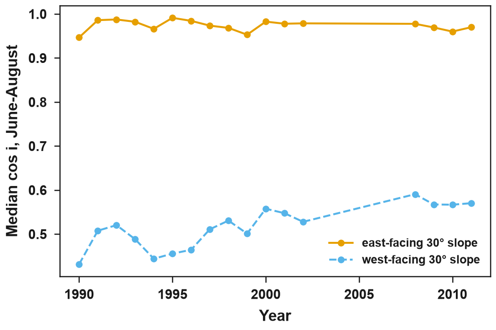
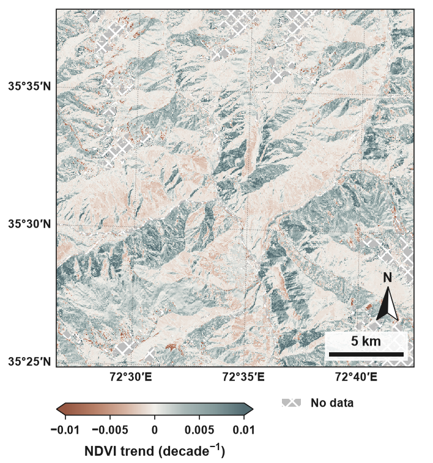
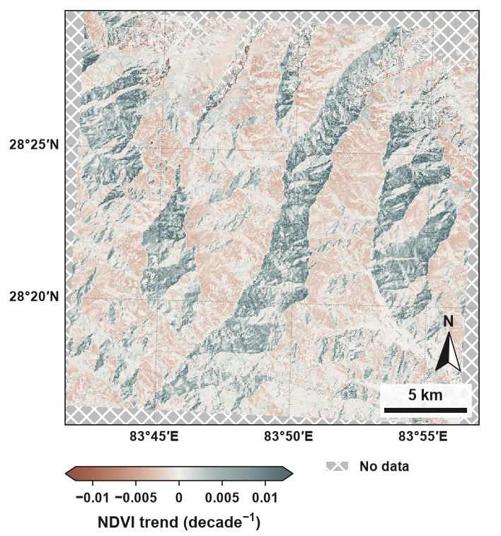

# Gallery

!!! note "Made with the development version"
    The maps below come from `diagnose` exports made before the 0.1 release. Their drift trend and
    risk class are computed as in 0.1; the uncertainty bracket (`share_low`, `share_high`) used an
    earlier, narrower setting and is not shown. They will be replaced by maps from the released 0.1.
    They show NDVI; for drift checks use NIRv or EVI (see [Drift artefact](drift.md)).

Figures made with [eofigs](https://kmkamilkhel.github.io/eofigs/) 0.2.0 by
`docs/scripts/build_gallery.py`.

## Landsat 5 orbit drift, seen from the sun angles

Median cos i of a 30° east-facing and a 30° west-facing slope at the Landsat 5 overpasses of June
to August (56 scenes, 1990-2011), Kalam, upper Swat (35.5° N; WRS 151/035). The same season every
year: the rise on the west-facing slope comes from the later overpass, not from the forest. No
pixels are needed for this figure, only the scene sun angles.

## Drift artefact, Kalam, Landsat 5

Drift trend of NDVI, Landsat 5 (1990-2011, 172 scenes), Kalam tile (WRS 151/035; 24 km, scene grid 30 m): the
trend that the changing illumination alone creates, per decade. Colours are limited to ±0.01
decade⁻¹ (98th percentile of |slope|); 1.1 % of pixels exceed this. Grey with cross-hatching: no
data (6.6 % of pixels). Risk classes: low 63.4 %, medium 7.0 %, high 0.7 %, no trend 15.2 %, not
assessable 13.7 % of pixels.

## Drift artefact, Ghandruk, Landsat 5

Drift trend of NDVI, Landsat 5 (1990-2011, 156 scenes), Ghandruk tile, Annapurna (28.4° N; WRS 142/040; 24 km, scene grid
30 m), per decade. Colours are limited to ±0.012 decade⁻¹ (98th percentile of |slope|); 1.4 % of
pixels exceed this. Grey with cross-hatching: no data (12.1 % of pixels). Risk classes: low 71.4 %,
medium 6.7 %, high 0.7 %, no trend 13.4 %, not assessable 7.8 % of pixels.
