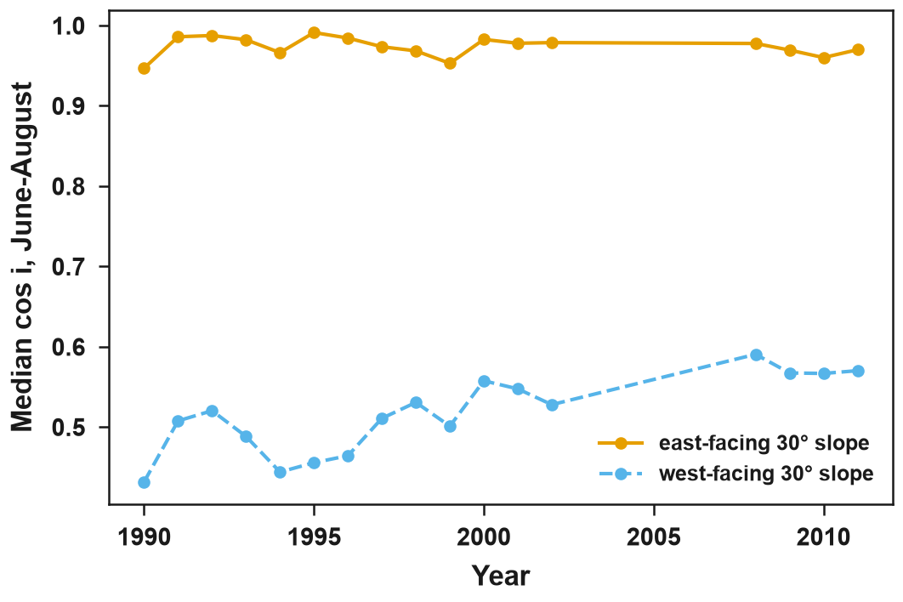

# topocorr

**Is a mountain trend real, or is it the sun?**

topocorr tests Landsat time series for illumination artefacts on slopes and corrects them
consistently through time, in Google Earth Engine.

On steep terrain the reflectance of a pixel depends on how directly the sun lights it. That
illumination changes between acquisitions with the season, with orbit drift (Landsat 5 and 7) and
with each sensor switch. A vegetation index can then show greening, browning or a break that comes
from geometry, not from the vegetation. topocorr computes the illumination of every pixel and
acquisition from the DEM and the image's sun angles, and

- flags cast shadow, self-shadow, low illumination and very steep slopes;
- applies the standard corrections (cosine, C, SCS+C) image by image;
- fits a [stack model](stack-model.md) once per site: the C coefficient as a smooth function of
  solar zenith, per band and stratum, so no image gets its own noisy coefficient;
- splits an observed index trend into its [illumination parts](drift.md) with `diagnose`;
- [compares the correction methods](compare.md) on one stack with one Earth Engine export.

Start with the [Installation](installation.md) and the [Quickstart](quickstart.md). The
[Validation](validation.md) page summarises the tests behind the methods, and the
[Gallery](gallery.md) shows maps from real sites.

Median cos i of 30° east- and west-facing slopes at the Landsat 5 overpasses of June to August,
Kalam (upper Swat, Hindu Kush, 35.5° N). As Landsat 5 crossed the equator later each year, the
west-facing slope was lit more directly in the same season: a trend that comes from the orbit,
not from the forest.

## Scope

| Version | Content |
|---|---|
| 0.1 (released) | Landsat 5, 7, 8 and 9 Collection 2 Level 2: `collection`, `masks`, `fit`, `correct`, `diagnose`, `compare_export`, `compare` |
| 0.2 (planned) | Sentinel-2 L2A harmonisation and break checks at sensor switches |
